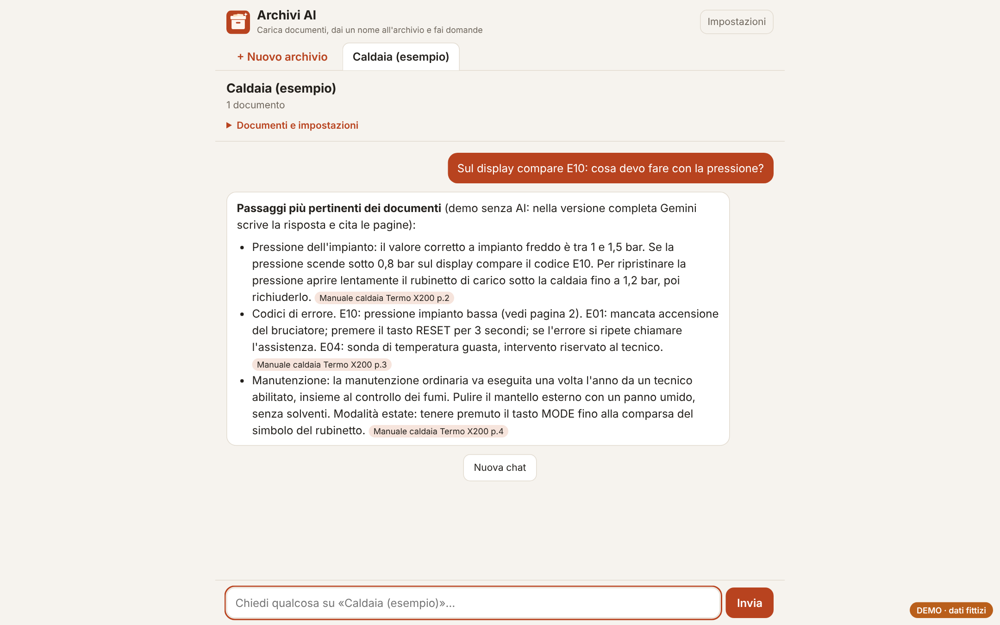
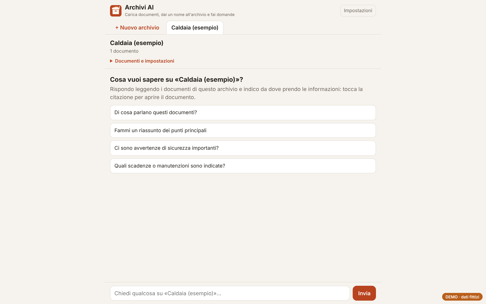
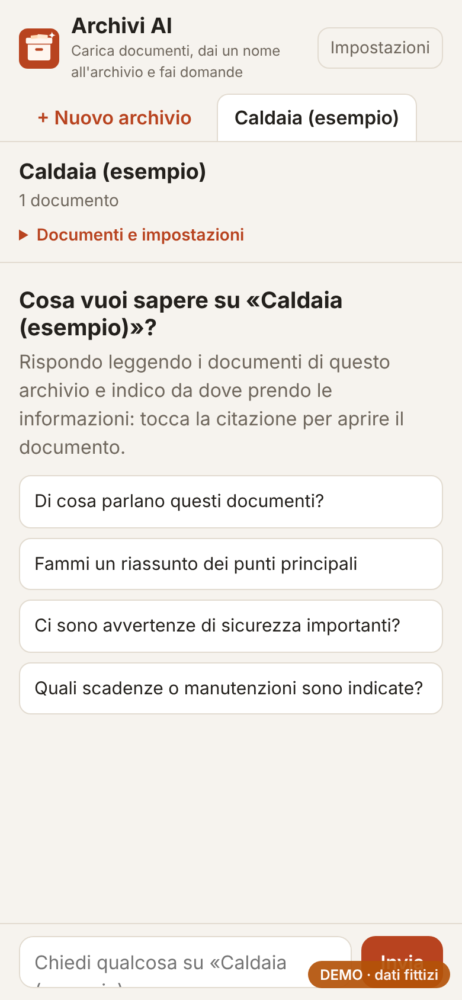

# Archivi AI

Archivi di documenti con un nome (es. "Caldaia", "Auto", "Contratti") a cui fare domande in linguaggio naturale. La risposta usa solo i documenti dell'archivio e cita documento e pagina.

**[Prova la demo](https://andreapollastrelli95.github.io/archivi-ai-demo/)** · contiene un manuale di esempio; i documenti che aggiungi restano solo nel tuo browser.

## Cosa fa

- **Archivi con un nome**, ognuno con i suoi documenti: PDF, Word, Excel, PowerPoint, testo, immagini, audio e video.
- **Lettura dei documenti nel browser** (pdf.js e lettori per i formati Office); foto, scansioni e file multimediali vengono trascritti dall'AI.
- **Domande con citazioni**: ogni informazione riporta `[documento p.N]`; se la risposta non è nei documenti lo dice, senza inventare.
- **Archivi grandi**: sotto circa 300.000 caratteri l'AI riceve tutti i documenti, oltre solo le pagine più pertinenti (ricerca per parole chiave con pesi BM25).
- **Modelli di riserva**: se il modello gratuito è sovraccarico prova automaticamente quelli successivi.
- Interfaccia pensata per il telefono, aggiungibile alla schermata Home.

| Archivio | Telefono |
|---|---|
|  |  |

## Come è fatto

- **Interfaccia**: una singola pagina HTML/JavaScript senza framework (`index.html`).
- **Versione completa**: backend su **Google Apps Script**; documenti e testo estratto salvati in Google Drive, risposte da **Google Gemini** (piano gratuito) con trascrizione dei file non testuali e OCR di Drive come riserva.
- **Demo**: `demo-run.js` sostituisce il backend con un archivio nel browser; al posto della risposta dell'AI mostra i passaggi più pertinenti dei documenti, con la stessa citazione.

---

Progetto di [Andrea Pollastrelli](https://andreapollastrelli95.github.io/).
